# Maquette V1 de Tuesday

Une page autonome, sans réseau (`index.html`), qui montre les vues du cahier des charges dans le cadre de référence de Grist (700 × 400), en clair et en sombre. **Les données sont fictives et rien n'est écrit nulle part.**

Pour l'ouvrir : servir le dépôt (`python3 -m http.server`) et aller sur `/maquettes/index.html` ; ou, une fois GitHub Pages activé, sur l'adresse du site. Les couleurs viennent du kit de GFS (`../kit/css/tokens.css`, sous-module).

## Le pupitre en haut de la page

- **Écran** : Tableau, Kanban, Calendrier, Chronologie, Fiche, Correspondance (les douze rôles), Explorateur GFS.
- **Premier lancement** (`onboarding.js`, `onboarding.css`) : Accès, Table (démarrage), Colonnes (confirmation), Une question (statut ambigu), Ouverture, Garder (pour l'équipe), Sans table, Modèle, Première tâche. Les écrans s'enchaînent comme le parcours de `../docs/onboarding.md` : Table → Continuer → Colonnes → Ouvrir → bandeau → Garder pour l'équipe.
- **Cadre** : 700 × 400 (le panneau de Grist), 1000 × 640, large.
- **Barre de GFS** : gauche (par défaut), haut, droite, bas, aucune. La barre est simulée par-dessus le cadre. Dans cette maquette, la zone qu'elle recouvre est libérée par une gouttière ; l'écartement ligne par ligne est à définir avec GFS (cahier, 8.5).
- **Thème** : clair, sombre.
- **Lecture seule** : tout est visible, les gestes d'écriture sont grisés avec leur raison.
- **Sans colonne Début** : la Chronologie est grisée et dit quoi relier.
- **Sans droit de créer une table** : « Garder pour l'équipe » explique le refus au lieu de créer.

Ce qui bouge dans la maquette : glisser une carte du kanban vers une autre colonne ou une tâche du calendrier vers un autre jour ; cliquer une pastille de statut (menu des choix) ; cliquer une ligne ou une carte (fiche) ; replier un groupe ; déplier les sous-tâches ; rechercher ; filtrer ; grouper ; changer le zoom de la chronologie ; naviguer de mois en mois. Chaque changement de statut ou de date affiche **« Annuler »** (Ctrl+Z aussi), comme le fera l'app.

## Captures (700 × 400)

| Écran | Clair | Sombre |
|---|---|---|
| Tableau |  |  |
| Kanban |  |  |
| Calendrier |  |  |
| Chronologie |  |  |
| Fiche d'une tâche |  |  |
| Correspondance des colonnes |  |  |
| Fiche : fichiers liés (Publipostage+) |  |  |
| Explorateur de GFS |  |  |

États : lecture seule ([clair](captures/tableau-lecture-seule-light.png)), chronologie sans colonne Début ([clair](captures/chronologie-sans-debut-light.png)), barre de GFS en haut ([clair](captures/tableau-barre-haut-light.png)) ou à droite ([sombre](captures/kanban-barre-droite-dark.png)).

Cadres plus larges (1000 × 640) : [tableau](captures/large-tableau-light.png), [kanban](captures/large-kanban-light.png), [calendrier](captures/large-calendrier-light.png), [chronologie](captures/large-chronologie-light.png).

Les captures se refont avec `node maquettes/outils/captures.cjs <port>` (Playwright, page servie en local).

## Ce que la maquette tranche, et ce qu'elle laisse ouvert

Choix faits (à valider, cahier section 13) :

- **Un projet = une table existante + une correspondance de colonnes**, jamais un modèle imposé (écran « Correspondance »).
- **Le premier écran propose les tables déjà là** (« Démarrage ») : un clic sur « Relier ».
- **Quatre vues** dans la barre ; la fonction qui manque est **grisée** et dit quoi faire.
- **Les statuts reprennent les couleurs de Grist** (ici, les couleurs sémantiques de la charte : gris, bleu, ambre, rouge, vert) ; le nom du statut est toujours écrit, le retard aussi (« En retard »).
- **Fiche à droite**, non modale, pour garder la vue sous les yeux (alternative : fenêtre de la base commune).
- **Icônes au trait**, police du système, un seul bleu, rayons de 7 px : la charte Grist Factory.

Ajouts du 02/11 (retours du porteur) : la fiche montre les **fichiers liés** (lier, ouvrir) et le menu « … » l'**insertion de la carte dans un document** (grisée, V2) ; une valeur de Référence est cliquable ; le calendrier est marqué **widget à part**, intégré (`../docs/integration-suite.md`).

Hors maquette, volontairement : la vue Semaine du calendrier, les dépendances, la charge de travail, la synthèse (V2), les menus d'édition d'une date, la version anglaise.

Écarts assumés avec le code final : la maquette utilise des styles en ligne (CSP assouplie sur `style-src`), alors que l'app aura la CSP stricte du kit et posera ses positions par le CSSOM ; les prénoms n'apparaissent pas (initiales et noms d'exemple), conformément à la règle de GFS.

## Premier lancement (700 × 400)

Conçu dans le fil « Concevoir l'onboarding de Tuesday » ; parcours, règles et textes : [`../docs/onboarding.md`](../docs/onboarding.md). **Décision du porteur (02/11) : on confirme toujours d'abord**, sur un seul écran déjà rempli, avec « Ouvrir » comme action principale.

| Écran | Clair | Sombre |
|---|---|---|
| Accès à Grist en attente | 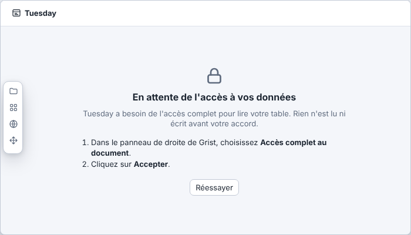 | 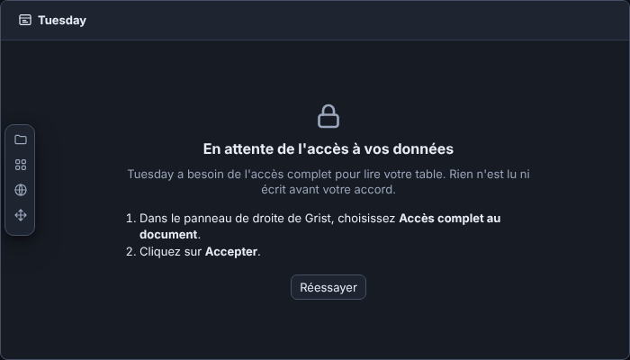 |
| Choisir la table |  |  |
| Confirmer les colonnes | 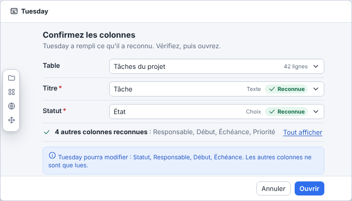 | 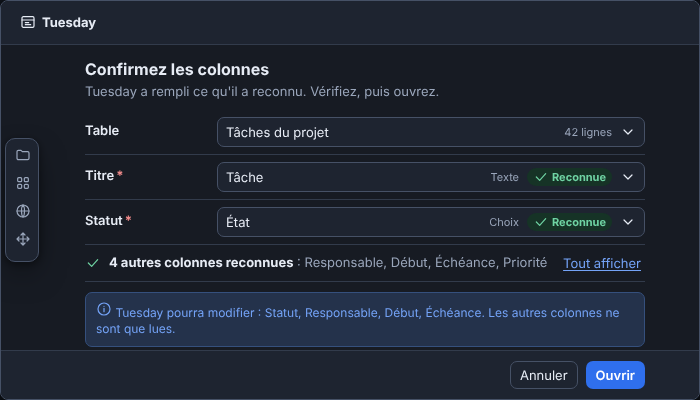 |
| Une question (statut ambigu) | 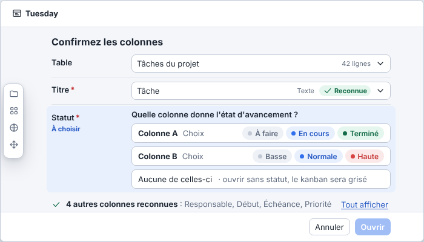 | 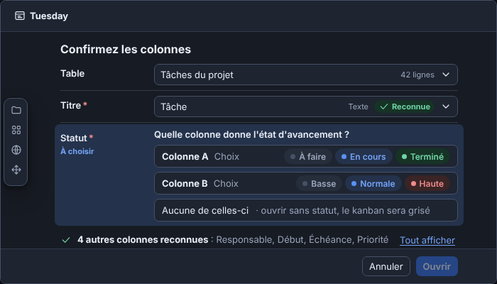 |
| Le projet s'ouvre, bandeau | 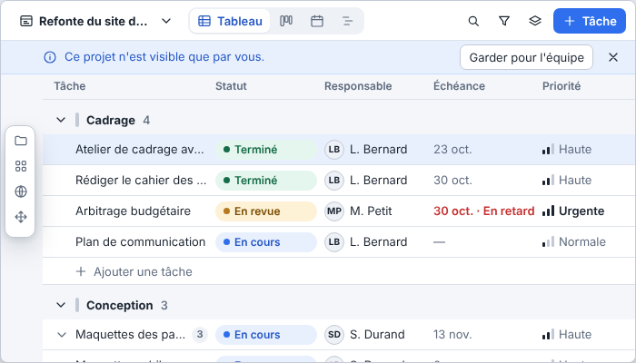 | 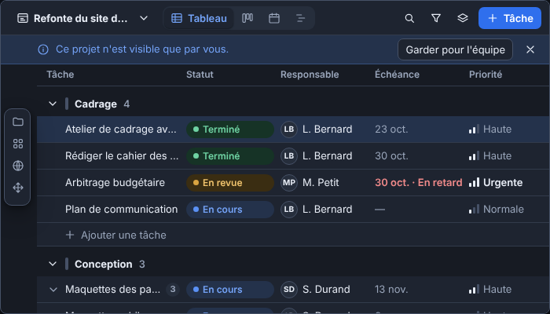 |
| Garder pour l'équipe | 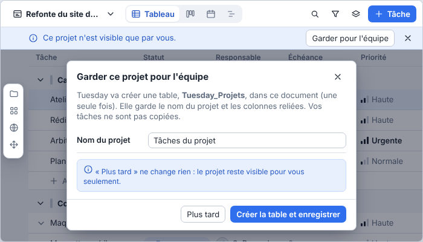 | 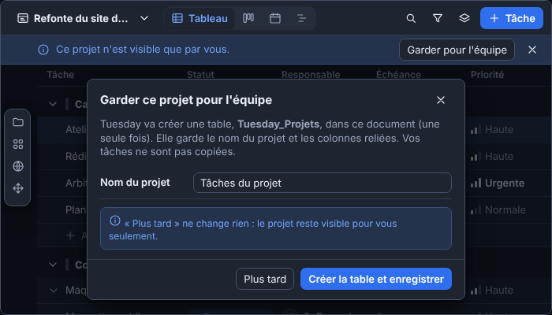 |
| … sans droit de créer la table | 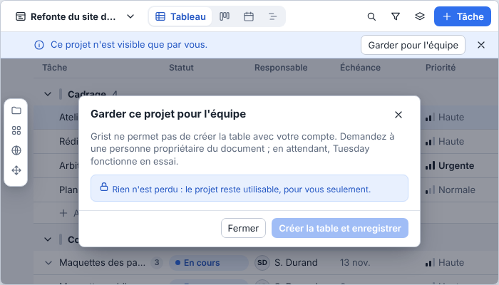 | 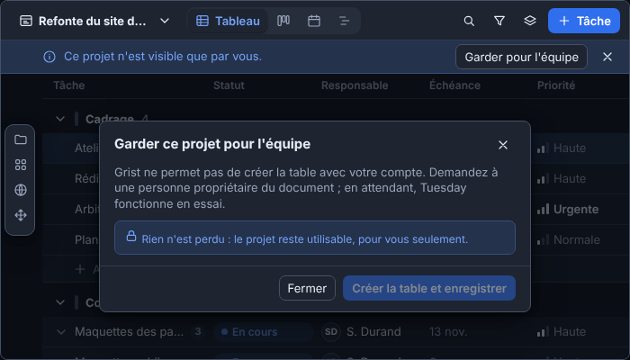 |
| Document sans table | 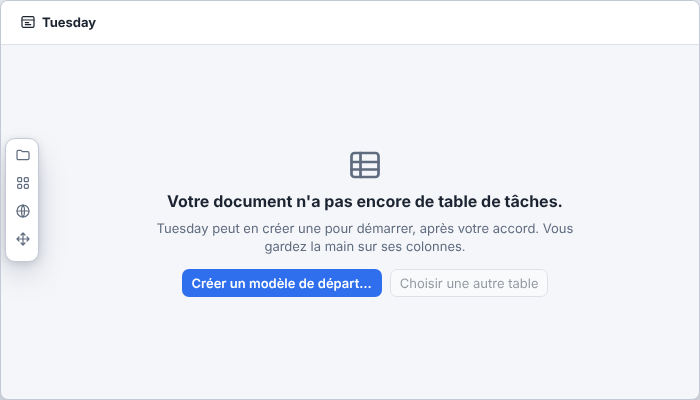 | 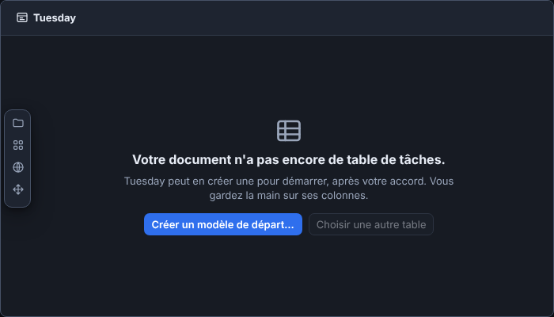 |
| Modèle de départ | 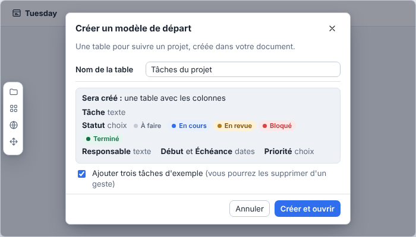 | 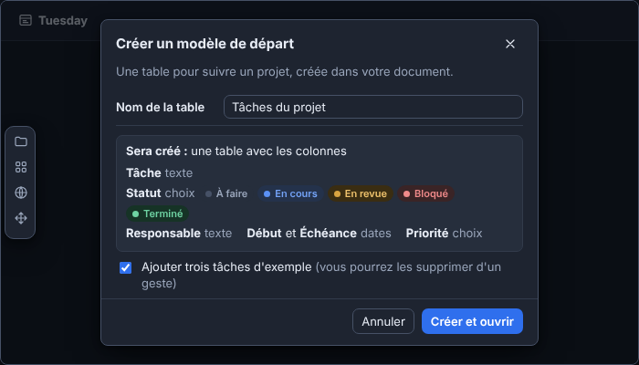 |
| Première tâche | 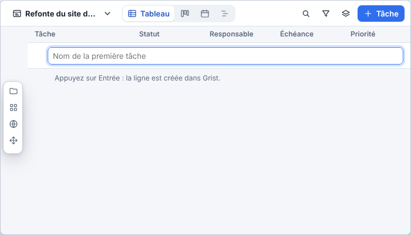 | 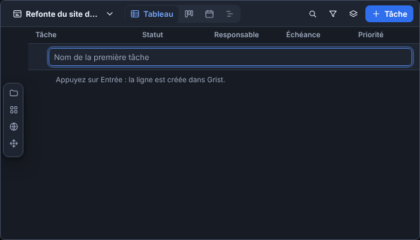 |

Les captures du premier lancement se refont avec `node maquettes/outils/captures.cjs <port> onboarding`.
